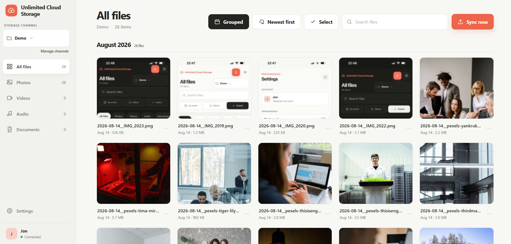
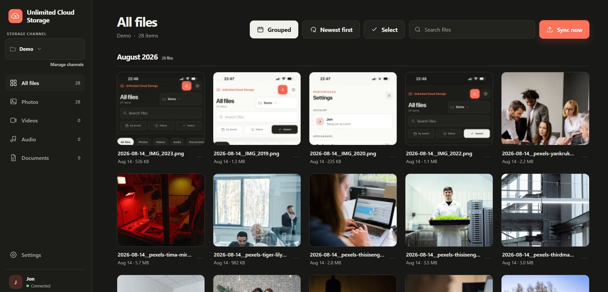
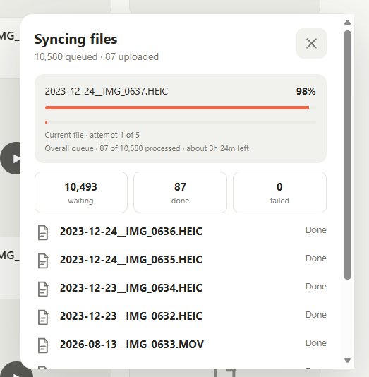
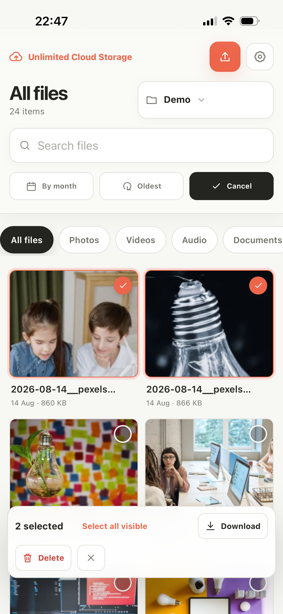
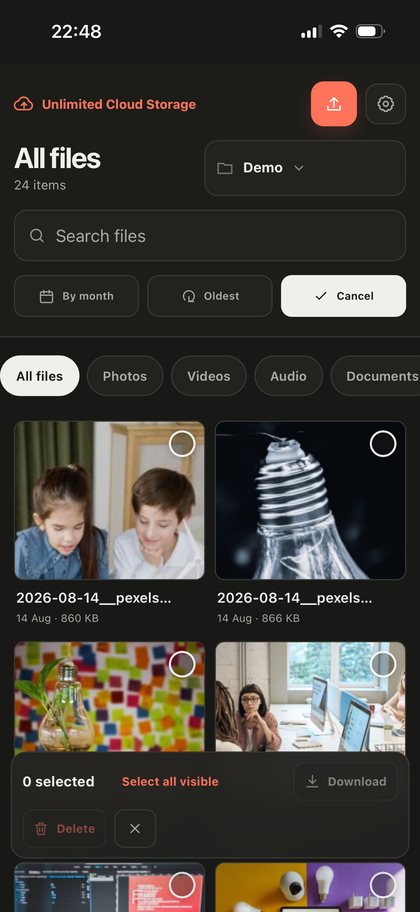
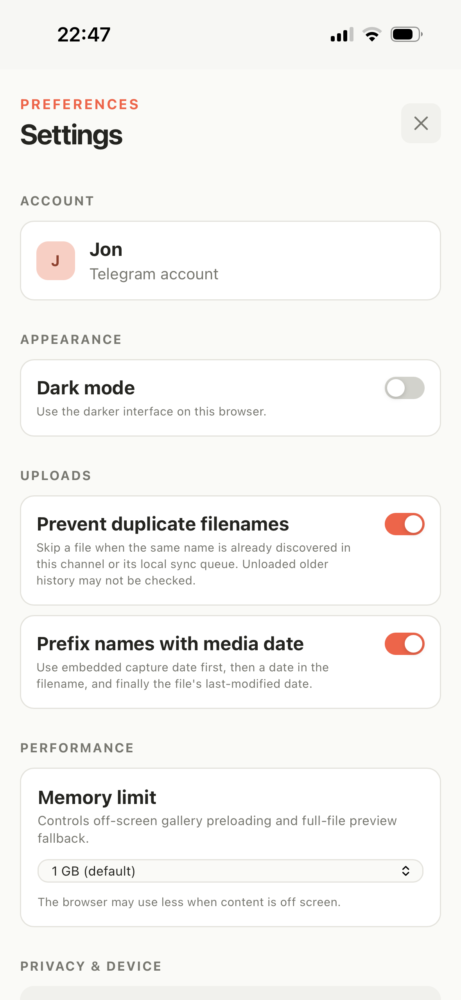
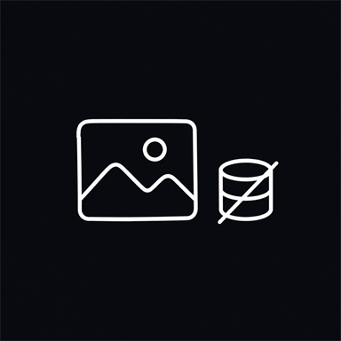
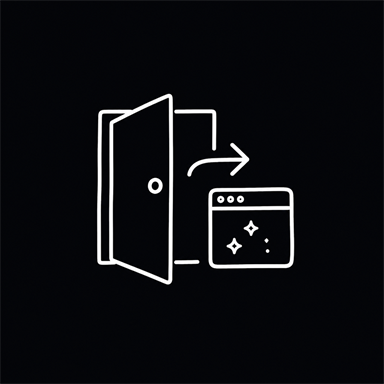

# Unlimited Cloud Storage

Telegram gives you effectively unlimited cloud-backed storage in private channels. Neat trick. This wrapper turns it into a simple photo and file drive that runs entirely in your browser.

There is no custom server in the middle. The app connects straight from your browser to Telegram, shows your files in a familiar gallery, and lets you upload whole folders without babysitting every file.

If something feels broken or confusing, [open an issue](https://github.com/JonKuqi/unlimited-cloud-storage/issues). Contributions are welcome too.

## See it in action

Once uploaded, everything appears in a clean gallery with search, file-type filters, month grouping, and media previews, including a local fallback for HEIC images. Download or delete one file at a time, or select a group and handle them together. Large videos can be viewed with no need for download.

<p align="center">
  
</p>
<p align="center">
  
</p>


Choose photos, videos, regular files, or a whole folder and leave the tab open. Everything joins one upload queue that you can pause or resume. Failed uploads retry automatically, and Telegram ratelimits are handled without throwing away the current file. Large folders can keep going for hours without loading every file into memory at once.

<table>
  <tr>
    <td width="80%"align="center">
      
    </td>
  </tr>
</table>

On a phone, add the site to your Home Screen and use it like a lightweight app. The same gallery and upload tools work on mobile, while your interface settings and optional saved session stay on that browser.
 
Settings let you change the theme, avoid duplicate filenames in one channel, add media dates to uploaded names - which is extracted from photo metadata and its useful for grouping by date, control memory use, and clear local data. Keep the page active during transfers because mobile browsers may suspend background work.

<table>
  <tr>
    <td width="33%" align="center">
      
    </td>
    <td width="33%" align="center">
      
    </td>
    <td width="33%" align="center">
      
    </td>
  </tr>
</table>

## Try it

[Open the live app →](https://jonkuqi.github.io/unlimited-cloud-storage/)

You will need your own Telegram API ID and API hash from [my.telegram.org/apps](https://my.telegram.org/apps). These are entered at runtime and are never included in this repository or deployment. Be careful to not share them with anyone!

## Run it locally

You need Node.js 20 or newer and npm.

```bash
git clone https://github.com/JonKuqi/unlimited-cloud-storage.git
cd unlimited-cloud-storage
npm install
npm run dev
```

Open the local URL printed by Vite. Useful checks before submitting a change:

```bash
npm run typecheck
npm run build
npm run test:upload
```

More implementation details live in the [developer documentation](docs/README.md).

## Deploy your own

Fork the repository, open Settings → Pages, and set the source to GitHub Actions. Pushing to `main` runs the included workflow and publishes the static build.

No Telegram credentials belong in GitHub secrets or the workflow. Each user enters their own credentials in the browser.

## Security

<table>
  <tr>
    <td width="50%" align="center">
      
      <br><sub>The app is static and has no custom backend. Telegram traffic goes directly from your browser to Telegram over MTProto.</sub>
    </td>
    <td width="50%" align="center">
      
      <br><sub>Your API credentials and session are saved only when you choose Keep me signed in. Login codes and two-step verification passwords stay in memory for the active request.</sub>
    </td>
  </tr>
  <tr>
    <td width="50%" align="center">
      
      <br><sub>The service worker never caches original files. IndexedDB holds disposable thumbnails and lightweight queue metadata.</sub>
    </td>
    <td width="50%" align="center">
      
      <br><sub>Forget this browser clears local app data. Log out of Telegram also revokes the current Telegram session.</sub>
    </td>
  </tr>
</table>

## License

[MIT](LICENSE)
